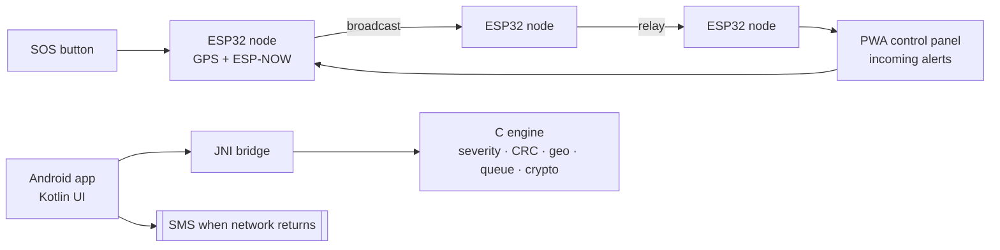

<div align="center">


# 🆘 My SOS — Offline Emergency Mesh

### Offline-first SOS toolkit — ESP32 ESP-NOW mesh firmware, Web Serial PWA and an Android app with a C engine

      

[](LICENSE)    

[](https://codespaces.new/shiroonigami23-ui/my-sos-app?quickstart=1) [](https://github.com/shiroonigami23-ui/my-sos-app/archive/refs/heads/main.zip)

[**Overview**](#-overview) · [**Features**](#-features) · [**Architecture**](#-architecture) · [**Getting Started**](#-getting-started) · [**Roadmap**](#-roadmap)

</div>

---

## 📖 Overview

**My SOS** is an emergency-messaging toolkit for places with **no mobile network**. Cheap **ESP32** boards form an
**ESP-NOW mesh**: press the button and the node broadcasts a JSON SOS packet with **GPS coordinates**; every node that
hears it **re-broadcasts** it to extend range. A **PWA control panel** connects to a node over **Web Serial (USB)** to trigger and monitor alerts,
and a native **Android app** builds structured SOS payloads using a **C engine over JNI** — severity score, CRC digest,
geo-distance, queueing and crypto — then hands off to SMS when a network is available.

### ✨ Highlights

- **No infrastructure needed** — ESP-NOW peer-to-peer mesh with relay logic
- **GPS-tagged JSON alerts** from the firmware
- **Native C engine** (JNI): severity 0–100, CRC digest, haversine distance, queue, crypto
- **Tag → signed APK** release via GitHub Actions

## 🧩 Features

| Feature | What it does |
|---|---|
| **ESP32 firmware** | `firmware/esp32_sos_firmware.ino` — GPS read, ESP-NOW broadcast, mesh relay, push-button trigger |
| **PWA control panel** | `pwa/` — connect to a device, trigger SOS, live incoming-alert feed, offline service worker |
| **Android app** | Kotlin UI that composes timestamped, geo-tagged SOS messages |
| **C SOS engine** | `sos_engine.c`, `geo_math.c`, `sos_queue.c`, `sos_crypto.c` via `jni_bridge.c` |
| **SMS hand-off** | Opens the SMS app with a prefilled emergency payload |
| **Release pipeline** | `.github/workflows/android-release.yml` builds and uploads the APK on tag |

## 🛠 Tech Stack

| Layer | Technology |
|---|---|
| Firmware | Arduino C++ for ESP32, ESP-NOW, GPS module |
| Web | PWA (HTML, JS, service worker) |
| Mobile | Kotlin + C (NDK/CMake, JNI) |
| CI | GitHub Actions |

## 🏗 Architecture

Three tiers — mesh nodes in the field, a PWA controller, and a phone app with a native engine.



➡️ Full design notes, data flow and design decisions: **[docs/ARCHITECTURE.md](docs/ARCHITECTURE.md)**

## 📁 Project Structure

```text
my-sos-app/
├── firmware/esp32_sos_firmware.ino   # mesh firmware
├── pwa/                              # index.html, manifest.json, sw.js
└── android-app/
    └── app/src/main/cpp/             # jni_bridge.c, sos_engine.c, geo_math.c, sos_queue.c, sos_crypto.c, CMakeLists.txt
```

## 🚀 Getting Started

### Prerequisites

- ESP32 dev board, GPS module (e.g. NEO-6M), push button
- Arduino IDE / arduino-cli with the ESP32 core
- JDK 17 + Android SDK/NDK for the app

### 1. Get the code

Pick whichever method suits you:

| Method | Command |
|---|---|
| **HTTPS** | `git clone https://github.com/shiroonigami23-ui/my-sos-app.git` |
| **SSH** | `git clone git@github.com:shiroonigami23-ui/my-sos-app.git` |
| **GitHub CLI** | `gh repo clone shiroonigami23-ui/my-sos-app` |
| **ZIP** | [Download](https://github.com/shiroonigami23-ui/my-sos-app/archive/refs/heads/main.zip) and extract |
| **Codespaces** | [Open in browser](https://codespaces.new/shiroonigami23-ui/my-sos-app?quickstart=1) — zero local setup, dev container preconfigured |

> 🔑 **Using SSH for the first time?** Generate a key with `ssh-keygen -t ed25519 -C "you@example.com"`, add the `.pub` contents at **GitHub → Settings → SSH and GPG keys**, then test with `ssh -T git@github.com`.

### 2. Install & set up

```bash
cd my-sos-app
# Firmware: open firmware/esp32_sos_firmware.ino in Arduino IDE → select your ESP32 board → Upload
cd android-app && ./gradlew assembleDebug
```

### 3. Run

- Flash two or more ESP32 boards; press the button on one and watch the others relay.
- Serve `pwa/` over HTTPS (or `localhost`) in Chrome to use the control panel: `python3 -m http.server 8080 -d pwa`.
- Release APK: push a tag `vX.Y.Z` (signing secrets configured in the repo).

## 🎮 Usage

> ⚠️ This is a prototype. In a real emergency always contact official services (112 in India) if any network is available.

## 🗺 Roadmap

**Phase 2 — Toolkit (done)**

- [x] ESP-NOW mesh with GPS JSON alerts and relay
- [x] PWA control panel
- [x] Android app with native C engine + release workflow

**Phase 3 — Range & reliability**

- [ ] LoRa (SX1276) radio option for kilometre-scale range
- [ ] Message de-duplication + TTL in the relay logic
- [ ] Delivery acknowledgements and retry queue on the nodes

**Phase 4 — Usability**

- [ ] Styled PWA with map view of incoming SOS locations
- [ ] Bluetooth link between Android app and nearest node
- [ ] Battery-powered enclosure design (3D-printable)

➡️ Detailed plan, milestones and long-term vision: **[docs/ROADMAP.md](docs/ROADMAP.md)**

## 🤝 Contributing

Contributions, issues and feature requests are welcome!

1. Fork the repository
2. Create a feature branch: `git checkout -b feature/amazing-feature`
3. Commit your changes: `git commit -m "feat: add amazing feature"`
4. Push the branch: `git push origin feature/amazing-feature`
5. Open a Pull Request against `main`

Check the [issues page](https://github.com/shiroonigami23-ui/my-sos-app/issues) and the [roadmap](docs/ROADMAP.md) for ideas on where to help.

## 📜 Changelog

See [CHANGELOG.md](CHANGELOG.md) for the release history.

## 📄 License

Distributed under the **MIT** license. See [LICENSE](LICENSE) for details.

## 👤 Author

**Aryan Singh Chandel** (Shiro)

[](https://github.com/shiroonigami23-ui)

<div align="center">

⭐ **If you find this project useful, consider giving it a star!** ⭐

</div>
