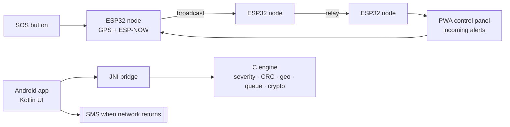

# 🏗 Architecture — My SOS — Offline Emergency Mesh

> Part of [my-sos-app](https://github.com/shiroonigami23-ui/my-sos-app). Back to the [README](../README.md).

## 1. System Overview

Field nodes run identical firmware: they read GPS, wait for the button, broadcast JSON over ESP-NOW and forward any
packet they receive. The PWA attaches to a node to send and display alerts. The Android app is independent: Kotlin UI
calls into a C library through JNI for computation and packaging, then uses SMS as the delivery channel.

## 2. Components

| Component | Location | Responsibility |
|---|---|---|
| **Firmware** | `firmware/esp32_sos_firmware.ino` | GPS, ESP-NOW send/receive, relay |
| **PWA** | `pwa/` | Control panel + service worker |
| **JNI bridge** | `android-app/app/src/main/cpp/jni_bridge.c` | Kotlin ↔ C calls |
| **Engine** | `sos_engine.c, geo_math.c, sos_queue.c, sos_crypto.c` | Payload, severity, distance, queue, crypto |

## 3. Data / Control Flow

1. Button press → firmware builds a JSON SOS with latitude/longitude and broadcasts it.
2. Neighbouring nodes receive and re-broadcast, extending range.
3. The PWA shows each incoming alert; the phone app can compose and send SMS alerts when possible.

## 4. Key Design Decisions

| Decision | Rationale |
|---|---|
| ESP-NOW | Router-less, low-latency peer-to-peer on cheap hardware |
| C engine via JNI | Deterministic, portable logic shareable with firmware |

## 5. Known Limitations

- Relay has no de-duplication yet (possible broadcast storms in dense meshes)

---
*Last updated: 2026-11-14*
